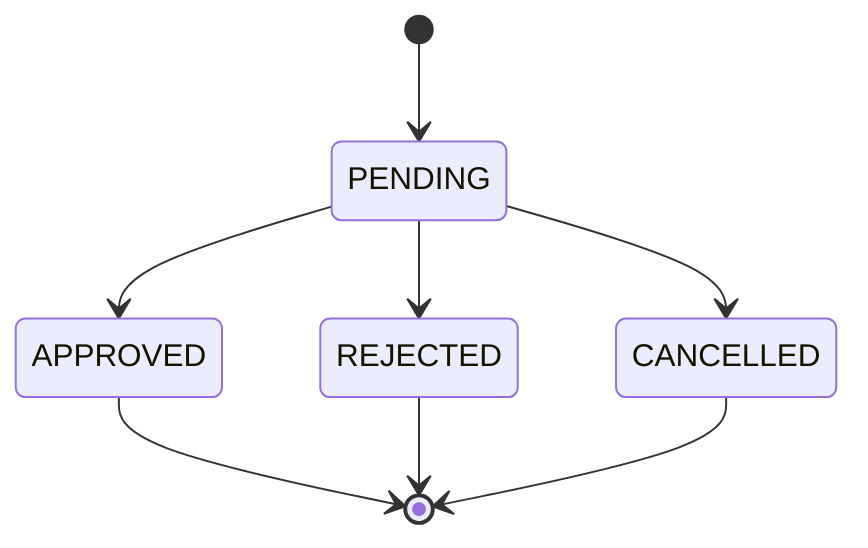
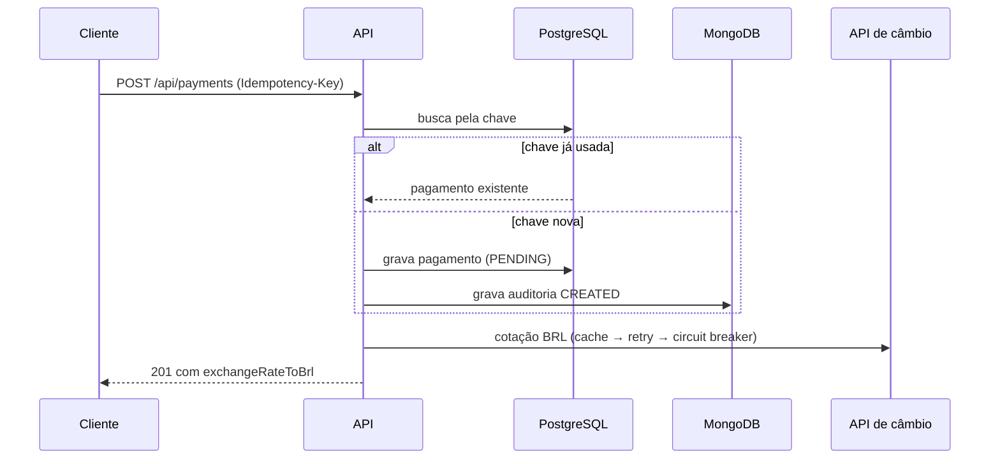
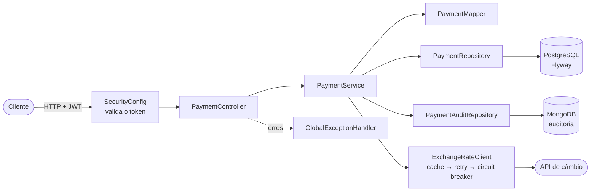
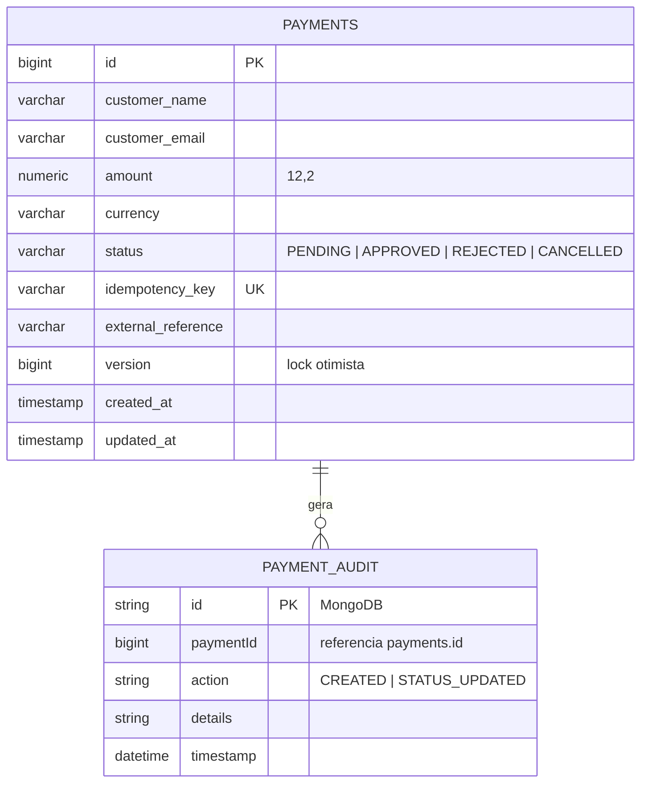

<h1 align="center">Payments API</h1>

<p align="center">
  API REST de pagamentos em Java 21 e Spring Boot 4, com PostgreSQL, auditoria em MongoDB,<br>
  cotação de câmbio via API externa, autenticação JWT e documentação OpenAPI.
</p>

<p align="center">
  <a href="https://github.com/josewilson/Payments-Gerenciamento-de-Pagamentos-Backend/actions/workflows/ci.yml"></a>
</p>

<p align="center">
  
  
  
  
  
  
  
  
  
</p>

---

## Sumário

- [Visão geral](#visão-geral)
- [Início rápido](#início-rápido)
- [Configuração](#configuração)
- [Autenticação](#autenticação)
- [API](#api)
- [Regras de negócio](#regras-de-negócio)
- [Estrutura do projeto](#estrutura-do-projeto)
- [Decisões técnicas](#decisões-técnicas)
- [Testes e CI](#testes-e-ci)
- [Produção](#produção)
- [Próximos passos](#próximos-passos)
- [Autor](#autor)

## Visão geral

Gerencia o ciclo de vida de pagamentos: criação, consulta paginada com filtro por status, mudança de status e trilha de auditoria. Cada pagamento é devolvido com a cotação da sua moeda em BRL.

| Área | O que a API entrega |
|---|---|
| **Confiabilidade** | Criação idempotente (`Idempotency-Key`), lock otimista e transições de status validadas |
| **Integração externa** | Cliente de câmbio tipado, com timeout, cache de 10 min, retry e circuit breaker |
| **Dados** | Valores em `BigDecimal`, migrações Flyway e auditoria separada no MongoDB |
| **Segurança** | JWT (HS256) em `/api/payments/**`, sem segredos no repositório |
| **Operação** | Docker Compose, health com probes, shutdown gracioso e CI |

## Início rápido

Pré-requisito: Docker.

```bash
cp .env.example .env          # defina as senhas e o JWT_SECRET
docker compose up -d --build
```

| Recurso | URL |
|---|---|
| API | http://localhost:8080 |
| Swagger UI | http://localhost:8080/swagger-ui/index.html |
| Health | http://localhost:8080/actuator/health |

Para rodar pela IDE ou com `./mvnw spring-boot:run`, suba apenas os bancos (`docker compose up -d postgres mongo`) e exporte as variáveis do `.env`.

## Configuração

Toda configuração sensível vem de variáveis de ambiente (modelo em [`.env.example`](.env.example)).

| Variável | Obrigatória | Padrão | Descrição |
|---|---|---|---|
| `DB_USER`, `DB_PASSWORD` | sim | — | Credenciais do PostgreSQL |
| `DB_HOST`, `DB_PORT`, `DB_NAME` | não | `localhost`, `5432`, `paymentsdb` | Conexão com o PostgreSQL |
| `MONGO_URI` | não | `mongodb://localhost:27017/payments_audit_db` | Conexão com o MongoDB |
| `JWT_SECRET` | sim | — | Chave HS256, mínimo 32 bytes (`openssl rand -base64 48`) |
| `EXCHANGE_RATE_URL` | não | `https://open.er-api.com/v6` | API de cotação |
| `MONGO_USER`, `MONGO_PASSWORD` | só no Compose | — | Credenciais do contêiner MongoDB |

## Autenticação

As rotas `/api/payments/**` exigem `Authorization: Bearer <jwt>`, assinado em HS256 com o `JWT_SECRET`. A API **valida** tokens; a emissão fica com o seu provedor de identidade.

<details>
<summary>Gerar um token de desenvolvimento</summary>

```bash
b64() { openssl base64 -A | tr '+/' '-_' | tr -d '='; }
H=$(printf '{"alg":"HS256","typ":"JWT"}' | b64)
P=$(printf '{"sub":"dev","exp":%s}' $(( $(date +%s) + 3600 )) | b64)
S=$(printf '%s.%s' "$H" "$P" | openssl dgst -binary -sha256 -hmac "$JWT_SECRET" | b64)
export TOKEN="$H.$P.$S"
```

</details>

Rotas públicas: `/actuator/health/**`, `/actuator/info`, `/swagger-ui/**` e `/v3/api-docs/**`.

## API

| Método | Rota | Descrição |
|---|---|---|
| `POST` | `/api/payments` | Cria um pagamento (header `Idempotency-Key` obrigatório) |
| `GET` | `/api/payments?status=&page=&size=` | Lista com paginação (máx. 100 por página) e filtro por status |
| `GET` | `/api/payments/{id}` | Busca por id |
| `PATCH` | `/api/payments/{id}/status` | Altera o status (somente a partir de `PENDING`) |
| `GET` | `/api/payments/{id}/audit` | Trilha de auditoria do pagamento |

### Exemplo: criar pagamento

```bash
curl -X POST http://localhost:8080/api/payments \
  -H "Authorization: Bearer $TOKEN" \
  -H "Idempotency-Key: pedido-123" \
  -H "Content-Type: application/json" \
  -d '{
        "customerName": "Ana Souza",
        "customerEmail": "ana@email.com",
        "amount": 199.90,
        "currency": "USD",
        "externalReference": "PEDIDO-123"
      }'
```

```json
{
  "id": 1,
  "customerName": "Ana Souza",
  "customerEmail": "ana@email.com",
  "amount": 199.90,
  "currency": "USD",
  "status": "PENDING",
  "externalReference": "PEDIDO-123",
  "createdAt": "2026-11-06T19:39:53",
  "updatedAt": "2026-11-06T19:39:53",
  "exchangeRateToBrl": 5.468173
}
```

Repetir a requisição com a mesma `Idempotency-Key` devolve o mesmo pagamento, sem criar outro.

### Exemplo: aprovar pagamento

```bash
curl -X PATCH http://localhost:8080/api/payments/1/status \
  -H "Authorization: Bearer $TOKEN" \
  -H "Content-Type: application/json" \
  -d '{"status": "APPROVED"}'
```

### Erros

Formato único: `{ "timestamp", "status", "error", "message" }`, com `validationErrors` nos erros 400.

| Código | Quando |
|---|---|
| `400` | Dados inválidos ou `Idempotency-Key` ausente |
| `401` | Token ausente, inválido ou expirado |
| `404` | Pagamento não encontrado |
| `409` | Transição de status inválida ou atualização concorrente |
| `503` | Cotação indisponível. Repita com a mesma `Idempotency-Key` |
| `500` | Erro interno (a mensagem da exceção não é exposta) |

## Regras de negócio

### Status



Somente `PENDING` pode mudar de estado; os demais são terminais. Uma transição inválida retorna `409`.

### Criação de pagamento



Pagamentos em `BRL` não consultam a API externa (cotação 1).

## Estrutura do projeto

### Diagrama de componentes



### Modelo de dados



### Árvore de diretórios

```text
.
├── .github/workflows/ci.yml        # CI: ./mvnw verify
├── specs/                          # especificações e roadmap
├── src/
│   ├── main/
│   │   ├── java/com/josewilson/payments/
│   │   │   ├── PaymentsApplication.java
│   │   │   ├── controller/         # PaymentController
│   │   │   ├── service/            # PaymentService (regras de negócio)
│   │   │   ├── repository/         # PaymentRepository (JPA), PaymentAuditRepository (Mongo)
│   │   │   ├── domain/             # Payment, PaymentAudit, PaymentStatus
│   │   │   ├── dto/                # PaymentRequestDTO, PaymentResponseDTO, PaymentStatusUpdateDTO
│   │   │   ├── mapper/             # PaymentMapper
│   │   │   ├── client/             # ExchangeRateClient, ExchangeRateResponse
│   │   │   ├── config/             # Security, Jwt, Cache, RestClient, OpenApi, Web
│   │   │   └── exception/          # exceções de domínio e GlobalExceptionHandler
│   │   └── resources/
│   │       ├── application.yml
│   │       └── db/migration/       # V1__payment, V2__idempotency_key, V3__payment_version
│   └── test/java/com/josewilson/payments/
│       ├── client/                 # ExchangeRateClientTest (WireMock)
│       ├── config/                 # CotacaoCacheTest, CotacaoResilienceTest
│       ├── controller/             # PaymentControllerTest (MockMvc)
│       ├── domain/                 # PaymentStatusTest
│       ├── service/                # PaymentServiceTest, PaymentStatusFlowTest
│       └── integration/            # PaymentIntegrationTest (Testcontainers)
├── Dockerfile                      # imagem multi-stage, usuário não-root
├── docker-compose.yml              # postgres + mongo + app
├── .env.example                    # modelo das variáveis de ambiente
├── CLAUDE.md                       # guia para agentes de código
└── pom.xml
```

Especificações detalhadas em [`specs/`](specs/README.md).

## Decisões técnicas

| Decisão | Motivo |
|---|---|
| `Idempotency-Key` com índice único | Retentativas do cliente (ou do próprio 503) não duplicam cobrança, mesmo em requisições concorrentes |
| `BigDecimal` para valores e cotação | Evita erros de arredondamento de ponto flutuante em dinheiro |
| Cache acima de retry e circuit breaker | Acertos de cache não diluem a taxa de falha do circuito |
| BRL fora do circuit breaker | Um circuito aberto não pode derrubar pagamentos que não dependem da API externa |
| `@Version` (lock otimista) | Duas mudanças de status concorrentes não se sobrescrevem; a segunda recebe `409` |
| Flyway com `ddl-auto: validate` | O schema só muda por migração versionada |
| Falha de câmbio vira `503` | Erro explícito em vez de `null` silencioso |
| Auditoria no MongoDB | Trilha separada dos dados transacionais |

## Testes e CI

```bash
./mvnw verify    # exige Docker (Testcontainers)
```

| Camada | Cobertura |
|---|---|
| Unitários | Serviço (criação, idempotência, transições de status, auditoria) e regra de transição |
| Cliente de câmbio | WireMock: sucesso, 5xx, resposta sem BRL, timeout, cache, retry e circuit breaker |
| Controller | MockMvc com segurança (401 sem token, validação do header) |
| Integração | Spring Boot completo com PostgreSQL e MongoDB reais (Testcontainers) |

O workflow [`ci.yml`](.github/workflows/ci.yml) executa `./mvnw verify` a cada push e pull request.

## Produção

Checklist de implantação:

- [ ] `DB_PASSWORD`, `MONGO_PASSWORD` e `JWT_SECRET` fortes, vindos de um gerenciador de segredos (nunca do repositório)
- [ ] Bancos gerenciados ou com backup; volumes persistentes
- [ ] HTTPS terminado em um proxy ou balanceador à frente da API
- [ ] Probes do orquestrador em `/actuator/health/liveness` e `/actuator/health/readiness`
- [ ] Imagem Docker publicada a partir do `Dockerfile` (multi-stage, usuário não-root)

## Próximos passos

- Publicar `PagamentoStatusAlterado` em fila (quando houver mensageria no ecossistema)
- Métricas e tracing (Micrometer/OpenTelemetry) e logs estruturados
- Testes de arquitetura (ArchUnit)

## Autor

<p align="center">
  Desenvolvido por <strong>José Wilson Alves de Souza</strong> para fins de estudo, prática em back-end Java e portfólio profissional.
</p>
